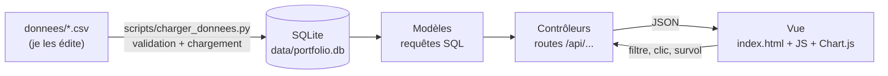
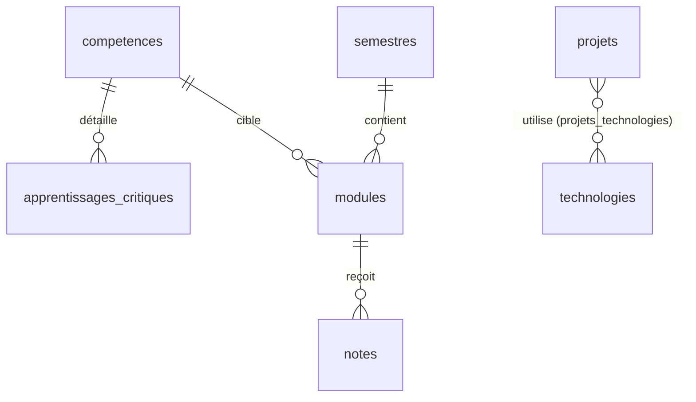

# Architecture generale du site

Projet de programmation web , Tshazly , BUT Science des Donnees (parcours VCOD) , IUT Besancon-Vesoul, site de Dole
Version 1 :  du 09/10/2026 (S41),  a faire valider au TD2 (S43)

Ce document repond aux trois points laisses ouverts a la page 7 de la maquette et explique comment je compte construire le site, de la donnee jusqu'a l'ecran.

## 1. Ce que le site doit faire

Un visiteur (un employeur, une école) arrive sur la page, voit qui je suis, puis parcourt mes compétences, mes notes, mes projets et mes documents à travers des graphiques qu'il peut filtrer. Tout ce qu'il voit est calculé à partir de mes données, rangées dans le dossier `donnees/`. Rien n'est écrit en dur dans la page.

## 2. Les décisions

 Question de la maquette (p. 7) , Décision , Pourquoi , À confirmer ,

Une page à défilement ou des pages séparées ?  Une seule page, avec un menu à ancres , La maquette a déjà un menu fixe avec la section active soulignée, et chaque section tient sur un écran. Les données ne sont chargées qu'une fois.  TD2 ,
Quelle bibliothèque de visualisation ? Chart.js , Elle suffit pour tous les graphiques de la maquette (courbe, histogramme, barres avec infobulle au survol) et reste légère. D3 est plus puissant, mais il faut bien plus de code pour arriver au même résultat. TD2 ,
 Quelle base de données ? SQLite, un seul fichier (`data/portfolio.db`)  Mes données tiennent en quelques centaines de lignes, il n'y a rien à installer et je peux reconstruire la base à partir des CSV. TD3 
, Contenu des cartes de technologies et catégories de projets , Définis dans les CSV : 4 familles (Langages, Données, Visualisation, Outils) et 3 catégories (Académique, Personnel, Santé et secteur public)  C'est ce que montrent les pages 3 et 5 de la maquette. Quand les données seront définitives 

Je ne connais pas encore la  technique imposée au TD2, notamment le langage . En attendant, je pars sur Python avec Flask, parce que c'est le langage que je pratique le plus. Si le TD2 impose autre chose (PHP, Node.js…), je ne changerai que le contrôleur. Le schéma SQL, les CSV, les routes JSON et le front resteront les mêmes.

## 3. Vue d'ensemble



Le découpage suit le modèle MVC (modèle, vue, contrôleur) :

- Le modèle, c'est la base SQLite et les fonctions qui l'interrogent (`app/modeles/`). Elles ne savent rien de HTTP ni de HTML.
- Le contrôleur, ce sont des routes `/api/...` qui reçoivent les filtres, appellent le modèle et renvoient du JSON (`app/controleurs/`).
- La vue, c'est une page HTML et du JavaScript qui appellent l'API et dessinent les graphiques (`app/static/`).

## 4. Organisation du dépôt

```
tshazly-man-tte/
** README.md
** AVANCEMENT
** choix_des_données
** architecture/
   ** ARCHITECTURE.md        ce document
** maquette/                   maquettes V1, V2…
** donnees/
    *.csv                   les jeux de données (voir DICTIONNAIRE.md)
    * schema.sql              structure de la base + vues
     * DICTIONNAIRE.md
** scripts/
   ** charger_donnees.py      valide les CSV et construit la base
** data/                       base générée (non versionnée)
** app/                        à créer en S48
    ** serveur.py              point d'entrée
    ** modeles/                accès à la base
    ** controleurs/            routes /api
    ** static/                 index.html, css/, js/, img/, documents/
```

## 5. Les données

J'ai neuf tables, décrites colonne par colonne dans `donnees/DICTIONNAIRE.md` et créées par `donnees/schema.sql`.



Les tables `documents` et `technologies` (hors liaison avec les projets) sont indépendantes des autres.

J'ai fait deux choix pour ne pas stocker la même information deux fois :

- Le volume horaire n'a pas sa propre table. Il est porté par `modules` (heures, compétence, semestre), et la vue `v_volume_horaire_competence` le regroupe par compétence et par année pour le graphique de la section Compétences.
- Une note ne stocke que sa valeur et son coefficient. Le semestre et la compétence se retrouvent par jointure avec `modules` (vue `v_notes_detail`). Filtrer sur « S3 » ou sur la compétence C2 ne demande donc aucune colonne en plus.

## 6. Les routes de l'API

 Section de la maquette , Route  , Paramètres , Contenu renvoyé  .

 Accueil , `GET /api/accueil`  aucun , 4 compteurs (`v_kpi_accueil`) et la liste des technologies .
 Compétences  `GET /api/technologies` , `famille` (Toutes, Langages, Données, Visualisation, Outils) cartes : nom, niveau, projets liés 
 BUT SD  `GET /api/competences`  aucun , les 4 compétences .
 BUT SD  `GET /api/competences/<code>`  aucun , apprentissages critiques de la compétence choisie .
 BUT SD  `GET /api/volume-horaire` , `annee` (1, 2, 3 ou toutes) heures par compétence (`v_volume_horaire_competence`) 
 Notes  `GET /api/notes` , `semestre` (S1 à S6 ou Tous), `module`  indicateurs, progression, distribution et notes par module, déjà filtrés |
 Projets  `GET /api/projets` , `categorie` cartes de projets .
 Projets | `GET /api/projets/<id>` aucun , détail : objectif, données, outils, difficultés, lien du code .
 Documents | `GET /api/documents` , `type` (Tous, CV, Attestations, Rapports)  liste des documents .

`/api/notes` renvoie tout en une seule réponse, parce que dans la maquette le filtre de semestre met à jour les indicateurs et les trois graphiques en même temps :

```json
{
  "indicateurs": {"moyenne": 11.4, "meilleure": 15, "plus_faible": 7, "evaluations": 12},
  "progression": [{"semestre": "S1", "moyenne": 11.56}, ...],
  "distribution": [{"tranche": "<8", "n": 1}, {"tranche": "8-10", "n": 3}, ...],
  "par_module": [{"module": "R1.04", "intitule": "Statistique descriptive 1", "note": 15}, ...]
}
```

Voici, côté modèle, la requête de la distribution, avec un filtre de semestre facultatif :

```sql
SELECT tranche, COUNT(*) AS n
FROM v_notes_tranche
WHERE (:semestre IS NULL OR semestre = :semestre)
  AND (:module   IS NULL OR module_code = :module)
GROUP BY tranche;
```

Les valeurs des filtres passent toujours par des paramètres liés (`:semestre`), jamais collées dans le texte de la requête.

## 7. Le front : un module JavaScript par section

 Section , Fichier JS , Appelle , Visualisation , interaction 

 Menu fixe , `menu.js` , aucune route , ancres, entrée active mise à jour au défilement 
 Accueil , `accueil.js` , `/api/accueil` , 4 compteurs, boutons vers Projets et Documents 
 Compétences et BUT SD , `competences.js` , `/api/technologies`, `/api/competences/<code>`, `/api/volume-horaire`  filtre de famille, sélecteur de compétence, barres par compétence avec filtre BUT 1/2/3 
 Notes , `notes.js` , `/api/notes`  filtre de semestre, menu des modules, courbe, histogramme, barres avec infobulle 
 Projets , `projets.js` , `/api/projets`  filtre de catégorie, fenêtre de détail 
 Documents et contact , `documents.js` , `/api/documents`  filtre de type, téléchargement, aperçu 

Prenons un clic sur « S3 » dans la section Notes. `notes.js` appelle `/api/notes?semestre=S3`, le contrôleur lance les quatre requêtes avec ce filtre et renvoie le JSON, puis `notes.js` met à jour les compteurs et les trois graphiques. La page ne se recharge pas.

## 8. Calcul des compteurs de l'accueil

 Compteur , Définition 

 Heures de formation , somme des heures des modules des semestres au statut `valide` 
 Moyenne générale , moyenne des notes pondérée par les coefficients 
 Projets réalisés , nombre de projets chargés dans la base 
 Semestres validés , nombre de semestres au statut `valide` 

Dans le BUT, la moyenne officielle d'un semestre passe par les UE et leurs pondérations. La moyenne que je calcule à partir de `notes.csv` n'est donc qu'une approximation. Pour la contrôler, j'utilise le champ `moyenne_officielle` de `semestres.csv` : le script me prévient quand l'écart dépasse 0,5 point.

## 9. Qualité des données

Chaque ligne des CSV a un `statut` :

- `ok` : la ligne est complète et sera publiée sur le site ;
- `a_valider` : la ligne est chargée, mais je dois la relire ;
- `a_completer` : la ligne est ignorée tant que je ne l'ai pas remplie.

La commande `python scripts/charger_donnees.py` vérifie les clés étrangères, les bornes (note entre 0 et 20, niveau entre 1 et 5), les valeurs autorisées, l'existence des fichiers de documents et les volumes horaires par rapport aux totaux nationaux. Elle affiche ce qu'il reste à compléter et s'arrête avec une erreur si une donnée est incohérente. La base est reconstruite à chaque exécution, donc les CSV restent ma seule source de vérité.

## 10. Vie privée

Le dépôt et le site sont publics, donc je choisis ce que je publie :

- pas d'adresse, de numéro de téléphone, de numéro étudiant ni de pièce d'identité dans les CSV ou dans les documents déposés ;
- seuls les documents listés dans `documents.csv` avec le statut `ok` sont accessibles depuis le site ;
- j'affiche mes notes parce que c'est le sujet du projet, mais je peux décider de ne montrer que les moyennes par semestre, en ne chargeant simplement pas les notes détaillées.

## 11. Exécution et mise en ligne

Mon README indique que je travaille directement sur GitHub, sans clone local. Or un site avec un contrôleur Python a besoin d'un serveur pour tourner. J'ai deux pistes, à trancher avec les consignes du TD2 :

1. GitHub Codespaces : un environnement de développement dans le navigateur. Je reste « directement sur GitHub » tout en pouvant exécuter du Python.
2. La publication pour les employeurs : GitHub Pages ne fait tourner aucun serveur. Pour une version publique, je peux soit déployer l'application chez un hébergeur Python gratuit (j'en vérifierai les conditions le moment venu), soit écrire un script d'export qui enregistre les réponses de l'API dans des fichiers JSON statiques, que le front lirait à la place de `/api`. Je dois choisir avant S49.

## 12. Calendrier

Il reprend mon planning du fichier `AVANCEMENT`.

 Étape , Semaine , Livrable .

 Architecture générale  S43 (23/10) , ce document, validé après le TD2 
 Préparation des données , S43 à S47 , CSV complétés, `charger_donnees.py` sans erreur ni ligne `a_completer` 
 Partie serveur , S48 (23/11)  `app/` : modèles et contrôleurs, routes testées 
 Visualisations , S48 (24/11)  graphiques Chart.js reliés à l'API 
 Interactions et filtres , S49 , filtres, fenêtre de détail, aperçu des documents 
 Tests, corrections, documentation , S49 , version finale 
## 13. Risques

- Si la pile du TD2 n'est pas Flask, seul le contrôleur change (voir § 2).
- Si mes données personnelles restent incomplètes (notes, volumes horaires par compétence), le site s'afficherait avec des graphiques vides. C'est la priorité de S43 à S47.
- Si la maquette évolue, les routes sont découpées par section, donc modifier l'une ne casse pas les autres. Chaque changement est noté dans le tableau de la page 7 de la maquette.