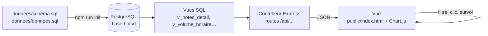
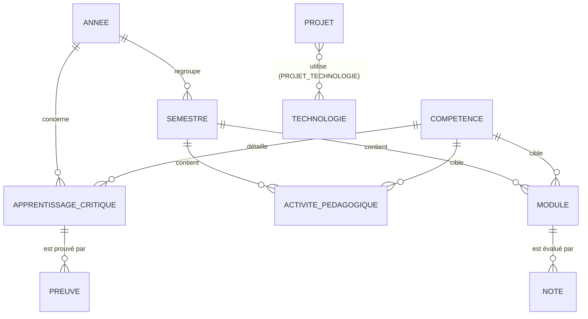

# Architecture générale du site

Projet de programmation web, Tshazly, BUT Science des Données (parcours VCOD), IUT Besançon-Vesoul, site de Dole.
Version 2 : mise à jour pour correspondre au code (V1 du 09/10/2026 : Flask + SQLite, à valider au TD2).

Ce document répond aux trois points laissés ouverts à la page 7 de la maquette et explique comment le site est construit, de la donnée jusqu'à l'écran.

## 1. Ce que le site doit faire

Un visiteur (un employeur, une école) arrive sur la page, voit qui je suis, puis parcourt mes compétences, mes notes, mes projets et mes documents à travers des graphiques qu'il peut filtrer. Tout ce qu'il voit est calculé à partir de la base de données (`donnees/`). Rien n'est écrit en dur dans la page.

## 2. Les décisions

| Question de la maquette (p. 7) | Décision | Pourquoi | À confirmer |
|---|---|---|---|
| Une page à défilement ou des pages séparées ? | Une page principale à ancres (`public/index.html`), plus une page de détail des compétences (`public/competences.html`) | Le menu fixe avec la section active soulignée est dans la maquette. La page principale charge toutes les données en une seule requête (`/api/portfolio`). | TD2 |
| Quelle bibliothèque de visualisation ? | Chart.js 4.4.1 | Elle suffit pour tous les graphiques de la maquette (courbe, histogramme, barres, camembert) et reste légère. | TD2 |
| Quelle base de données ? | PostgreSQL, base `butsd` | Choix retenu dans le code serveur. Le script crée la base, les tables et les données tout seul (`npm run init`). | TD3 |
| Contenu des cartes de technologies et catégories de projets | 4 familles (Langages, Données, Visualisation, Outils) et 3 catégories (Académique, Personnel, Santé et secteur public) | C'est ce que montrent les pages 3 et 5 de la maquette. Ces valeurs sont imposées par des contraintes `CHECK` dans la base. | Quand les données seront définitives |
| Langage du contrôleur | Node.js avec Express (`serveur/server.js`) | La V1 prévoyait Python et Flask « en attendant le TD2 ». Le code a été écrit en Node.js, et seul le contrôleur a changé : les routes JSON, la vue et le schéma restent ceux prévus. | TD2 |

## 3. Vue d'ensemble



Le découpage suit le modèle MVC (modèle, vue, contrôleur) :

- Le modèle, c'est la base PostgreSQL et ses vues SQL (`donnees/schema.sql`). Elles ne savent rien de HTTP ni de HTML.
- Le contrôleur, c'est `serveur/server.js` : des routes `/api/...` qui reçoivent les filtres, interrogent la base et renvoient du JSON.
- La vue, c'est du HTML et du JavaScript (`public/`) qui appellent l'API et dessinent les graphiques. Les filtres de la page principale sont appliqués dans le navigateur, sans rechargement.

## 4. Organisation du dépôt

```
tshazly-man-tte/
├── README.md
├── AVANCEMENT.md
├── choix_des_donnees.md
├── package.json               dépendances (express, pg) et commandes npm
├── .env.example               variables d'environnement possibles
├── architecture/
│   └── ARCHITECTURE.md        ce document
├── donnees/
│   ├── schema.sql             structure de la base : tables, contraintes, vues
│   ├── donnees.sql            les données (voir DICTIONNAIRE.md)
│   └── DICTIONNAIRE.md
├── serveur/
│   └── server.js              contrôleur Express + création de la base
├── public/                    servi tel quel par le serveur
│   ├── index.html             page principale
│   ├── competences.html       heures et preuves par compétence
│   └── img/                   photo.jpg et visuels des projets
├── preuves/                   images de preuve (servies sous /preuves)
├── maquette/                  maquettes (PDF et Word), servies sous /maquette
├── documents/                 documents publics (servis sous /documents)
└── prive/                     CV complet, lettre de motivation : jamais servis ni publiés
```

## 5. Les données

La base compte douze tables, décrites colonne par colonne dans `donnees/DICTIONNAIRE.md` et créées par `donnees/schema.sql`.



La table `DOCUMENT` est indépendante des autres.

Trois choix pour ne pas stocker la même information deux fois :

- Le volume horaire vient de `ACTIVITE_PEDAGOGIQUE` (une ligne par activité de mon emploi du temps, avec ses heures, son semestre et sa compétence). La vue `v_volume_horaire` le regroupe par compétence, par semestre et par année pour le graphique de la section BUT SD. `MODULE` ne porte donc pas d'heures.
- Une note ne stocke que sa valeur et son coefficient. Le semestre et la compétence se retrouvent par jointure avec `MODULE` (vue `v_notes_detail`). Filtrer sur « S3 » ou sur la compétence C2 ne demande aucune colonne en plus.
- Les preuves sont rattachées à un apprentissage critique, et donc à sa compétence, par la table `PREUVE`.

## 6. Les routes de l'API

| Section | Route | Paramètres | Contenu renvoyé |
|---|---|---|---|
| Page principale | `GET /api/portfolio` | aucun | toutes les données de la page en une seule réponse |
| Accueil | `GET /api/accueil` | aucun | 4 compteurs (`v_kpi_accueil`) et la liste des technologies |
| Compétences | `GET /api/technologies` | `famille` (Toutes, Langages, Données, Visualisation, Outils) | cartes : nom, niveau, projets liés |
| BUT SD | `GET /api/competences` | aucun | les 4 compétences |
| BUT SD | `GET /api/competence/<code>` (ou `/api/competences/<code>`) | aucun | la compétence, ses apprentissages critiques et ses preuves |
| BUT SD | `GET /api/apprentissage_critique` et `/api/apprentissage_critique/<id>` | `annee`, `competence` | apprentissages critiques |
| BUT SD | `GET /api/heures` (ou `/api/volume-horaire`) | `annee` (1, 2, 3 ou toutes) | heures par compétence |
| BUT SD | `GET /api/heures/semestre`, `GET /api/activites` | `competence`, `semestre` | heures par semestre, détail des activités |
| Notes | `GET /api/notes` | `semestre` (S1 à S6 ou Tous), `module` | indicateurs, progression, distribution et notes par module, déjà filtrés |
| Projets | `GET /api/projets` | `categorie` | cartes de projets |
| Projets | `GET /api/projets/<id>` | aucun | détail : objectif, données, outils, difficultés, lien du code |
| Documents | `GET /api/documents` | `type` (Tous, CV, Attestations, Rapports) | liste des documents |
| Technique | `GET /api/sante` | aucun | `{"ok": true}` si la base répond |

Un paramètre invalide renvoie une erreur 400 avec un message, une ressource inconnue une erreur 404, une panne de base une erreur 500 sans détail technique.

`/api/notes` renvoie tout en une seule réponse, parce que dans la maquette le filtre de semestre met à jour les indicateurs et les trois graphiques en même temps. La progression, elle, n'est pas filtrée par semestre : une courbe d'un seul point n'aurait pas de sens.

```json
{
  "indicateurs": {"moyenne": 11.4, "meilleure": 15, "plus_faible": 7, "evaluations": 12},
  "progression": [{"semestre": "S1", "moyenne": 11.56}],
  "distribution": [{"tranche": "<8", "n": 1}, {"tranche": "8-10", "n": 3}],
  "par_module": [{"module": "R1.04", "intitule": "Statistique descriptive 1", "note": 15}]
}
```

Voici, côté modèle, la requête de la distribution, avec les filtres facultatifs :

```sql
SELECT tranche, COUNT(*) AS n
FROM v_notes_tranche
WHERE ($1::int  IS NULL OR semestre_num = $1::int)
  AND ($2::text IS NULL OR module_code  = $2::text)
GROUP BY tranche;
```

Les valeurs des filtres passent toujours par des paramètres liés (`$1`, `$2`), jamais collées dans le texte de la requête.

## 7. Le front

| Page | Appelle | Visualisation / interaction |
|---|---|---|
| `index.html` (menu fixe, ancres, section active mise à jour au défilement) | `/api/portfolio` | 4 compteurs, filtre de famille, sélecteur de compétence, barres de volume horaire avec filtre BUT 1/2/3, filtre de semestre et menu des modules, courbe, histogramme, barres, filtre de catégorie, fenêtre de détail d'un projet, filtre de type de document, téléchargement et aperçu |
| `competences.html` | `/api/heures`, `/api/competence/<code>` | barres ou courbe, camembert, filtre d'année, description, apprentissages critiques et preuves de la compétence choisie |

Prenons un clic sur « S3 » dans la section Notes : la page recalcule les compteurs et les trois graphiques à partir des notes déjà chargées, sans nouvelle requête ni rechargement. La route `/api/notes?semestre=S3` donne le même résultat côté serveur et sert à tester l'API ou à alimenter une autre vue.

## 8. Calcul des compteurs de l'accueil

| Compteur | Définition |
|---|---|
| Heures de formation | somme des heures de toutes les activités pédagogiques enregistrées (`ACTIVITE_PEDAGOGIQUE`) |
| Moyenne générale | moyenne des notes pondérée par les coefficients (« — » tant qu'aucune note n'est saisie) |
| Projets réalisés | nombre de projets au statut `ok` ou `a_valider` |
| Semestres validés | nombre de semestres au statut `valide` (« — » tant qu'aucun ne l'est) |

Dans le BUT, la moyenne officielle d'un semestre passe par les UE et leurs pondérations. La moyenne calculée à partir de la table `NOTE` n'est donc qu'une approximation. Le champ `moyenne_officielle` de `SEMESTRE` sert de contrôle, et la courbe de progression l'utilise quand un semestre n'a pas encore de notes détaillées.

## 9. Qualité des données

Chaque ligne de `MODULE`, `NOTE`, `TECHNOLOGIE`, `PROJET` et `DOCUMENT` a un `statut` :

- `ok` : la ligne est complète et sera publiée sur le site ;
- `a_valider` : la ligne est chargée, mais je dois la relire ;
- `a_completer` : la ligne est ignorée par l'API tant que je ne l'ai pas remplie (sauf `MODULE`, toujours chargé). Pour un document, le chemin du fichier n'est alors jamais envoyé au navigateur.

Les contrôles sont faits par la base elle-même : clés étrangères, notes entre 0 et 20, niveaux entre 1 et 5, familles, catégories et types autorisés (contraintes `CHECK`). `npm run init` exécute `schema.sql` puis `donnees.sql` dans une seule transaction : si une donnée est incohérente, rien n'est modifié et PostgreSQL indique la ligne en cause.

## 10. Vie privée

Le dépôt et le site sont publics, donc je choisis ce que je publie :

- pas d'adresse, de numéro de téléphone, de date de naissance, de numéro étudiant ni de pièce d'identité dans la base ou dans les documents déposés ;
- le serveur ne publie que les dossiers `public/`, `preuves/`, `maquette/` et `documents/`. Le dossier `prive/` (CV complet, lettre de motivation) n'est jamais servi et est ignoré par Git (`.gitignore`) ;
- seuls les documents au statut `ok` ont un lien de téléchargement ;
- j'affiche mes notes parce que c'est le sujet du projet, mais je peux décider de ne montrer que les moyennes par semestre, en ne saisissant simplement pas les notes détaillées.

## 11. Exécution et mise en ligne

Un site avec un contrôleur Node.js et une base PostgreSQL a besoin d'un serveur : GitHub Pages ne suffit pas (il ne sert que des fichiers statiques). Deux situations :

1. **En local ou sur le poste du TD** : PostgreSQL et Node.js installés, puis `npm install`, `npm run init` et `npm start` (voir le README).
2. **Hébergé** : un hébergeur Node.js avec une base PostgreSQL (la connexion se règle avec `DATABASE_URL`). Le dépôt GitHub reste la source du code et des données.

## 12. Calendrier

Il reprend mon planning du fichier `AVANCEMENT.md`.

| Étape | Semaine | Livrable |
|---|---|---|
| Architecture générale | S43 (23/10) | ce document, validé après le TD2 |
| Préparation des données | S43 à S47 | `donnees.sql` complet : notes, niveaux des technologies, statuts des semestres |
| Partie serveur | S48 (23/11) | schéma, vues et contrôleur, routes testées |
| Visualisations | S48 (24/11) | graphiques Chart.js reliés aux données |
| Interactions et filtres | S49 | filtres, fenêtre de détail, aperçu des documents |
| Tests, corrections, documentation | S49 | version finale |

## 13. Risques

- Si la pile imposée au TD2 n'est pas Node.js, seul le contrôleur change (voir § 2) : le schéma SQL, les routes JSON et la vue restent les mêmes.
- Si mes données personnelles restent incomplètes (notes, niveaux des technologies, statuts des semestres), les graphiques correspondants s'affichent vides, avec un message. C'est la priorité de S43 à S47.
- Si la maquette évolue, les routes sont découpées par section, donc modifier l'une ne casse pas les autres. Chaque changement est noté dans le tableau de la page 7 de la maquette.
